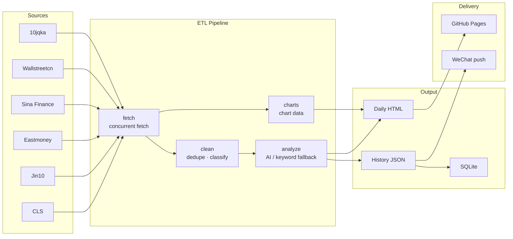

# Daily Sector Briefing

[简体中文](README.md) · **English**

> Aggregates fast news from six Chinese financial media outlets, applies AI analysis, and generates a daily briefing on four sectors: semiconductors, optical modules, innovative drugs, and gold.

[](https://chanbigcool.github.io/daily-stock-news/)  

**[Live report](https://chanbigcool.github.io/daily-stock-news/)** · **[Data query](https://chanbigcool.github.io/daily-stock-news/db.html)**


## Features

- **Multi-source aggregation** — Concurrently fetches fast news from CLS, Jin10, Eastmoney, Sina Finance, 10jqka, and Wallstreetcn, plus real-time quotes for 12 sector ETFs.
- **Event-level deduplication** — Coverage of the same event is merged into a single event via weighted Jaccard, bigram overlap, and numeric-signal similarity; each card shows the source count and related reports.
- **AI analysis** — A Claude-compatible API generates a Chinese headline, sector, direction, impact rating, confidence score, and rationale for every item. When the API is unavailable, a local keyword engine takes over and the briefing is still produced.
- **Sector direction calibration** — Sector direction follows the day's ETF move (±3% hard threshold), while each article is judged on its own content, preventing an all-bearish page on a sell-off day.
- **Visualization** — Four chart groups: ETF trend, sentiment distribution, sector direction, and impact heatmap. ETF prices accumulate daily.
- **History browsing** — Daily JSON and static HTML archives; any past date can be opened from the page.
- **Real SQL queries** — The full archive is loaded into a real SQLite database and queried in the browser through sql.js, with JOINs, subqueries, window functions, and `EXPLAIN`.
- **Automated publishing** — Scheduled cloud fetch plus GitHub Actions build and deploy, one-click refresh from the web page, and a daily WeChat digest.

## Architecture



## Tech Stack

| Layer | Choice |
|-------|--------|
| Runtime | Node.js ≥ 22, ESM, zero npm dependencies |
| Fetching | Native `fetch`; JSON / JS-variable / regex parsing |
| AI | Claude-compatible API (default GLM-4.5-Flash) with a local keyword-engine fallback |
| Rendering | String-built HTML with inline CSS / JS; Chart.js 4.4 vendored locally |
| Database | `node:sqlite` for builds; sql.js (WebAssembly) in the browser |
| Scheduling | Tencent Cloud SCF timer triggers (09:00 / 12:30 / 20:00 Beijing time) |
| Deployment | GitHub Actions + `peaceiris/actions-gh-pages` → GitHub Pages |
| Notifications | ServerChan 3 → WeChat |

## Quick Start

```bash
git clone https://github.com/chanbigcool/daily-stock-news.git
cd daily-stock-news

node scripts/build-daily.mjs     # fetch → clean → analyze → render
node scripts/refresh-server.mjs  # local preview at http://127.0.0.1:3456
npm test                         # run unit tests
```

There are no npm dependencies, so `npm install` is not required.

## Project Structure

```
daily-stock-news/
├── pipeline/          # ETL pipeline: fetch / clean / dedupe / analyze / charts
├── scripts/           # Build entry point, local preview server, SQLite build
├── cloud/             # Tencent Cloud SCF functions: fetch, refresh, scheduling
├── assets/            # Locally vendored frontend libraries (Chart.js, sql.js)
├── history/           # Daily archives (JSON / HTML / events / SQLite)
├── tests/             # Unit tests
├── docs/              # README preview image
├── index.html         # Daily report (deployment entry)
├── db.html            # Data query page
└── .github/workflows/ # CI: test, build, deploy
```

## Data Sources

| Source | Content | Parsing |
|--------|---------|---------|
| CLS | Telegraph-style fast news | JSON API |
| Jin10 | 24/7 market news | Injected JS variable |
| Eastmoney | General financial news | RESTful JSON |
| Sina Finance | Live financial news stream | JSON API |
| 10jqka | Rolling fast news | JSON API |
| Wallstreetcn | Global macro and China markets | RESTful JSON |

ETF quotes come from Sina's `hq.sinajs.cn` batch endpoint; no API key is required.

## AI Output Model

| Field | Description |
|-------|-------------|
| `title_cn` | Chinese industry headline |
| `summary_cn` | Factual summary with companies and figures |
| `category` | Semiconductors / Optical modules / Innovative drugs / Gold |
| `direction` | Bullish / Bearish / Neutral / Mixed |
| `impact` | Very high / High / Medium / Low |
| `certainty` | High / Medium / Low |
| `time_window` | Short / Medium / Long term |
| `tickers` | Related A-share tickers |
| `sentiment` / `market_impact` / `confidence_score` | Explanatory fields, kept consistent with `direction` / `impact` |
| `reasoning` | Rationale points |
| `evidence` | Verbatim factual sentences quoted from the source |
| `uncertainty` | Known uncertainties |

`evidence` may only quote facts present in the source; the model is not allowed to invent figures. When the API is unavailable, the keyword engine derives the same field set, so both paths share one contract.

## Automation Pipeline

1. Tencent Cloud SCF timer triggers fetch the news sources and ETF quotes three times a day, write the payload to the `fetch-cache` branch, and dispatch the workflow.
2. GitHub Actions reads the payload, runs cleaning, deduplication, analysis, rendering, and quality checks, commits the archive, and deploys to GitHub Pages.
3. The "Refresh" button on the page triggers the same pipeline through the cloud function; the page updates in about 2–6 minutes.

CI only consumes cloud-fetched data and never fetches on its own; local development fetches directly.

## Data Query

All history is normalized into a real SQLite database with four tables:

| Table | Contents |
|-------|----------|
| `news` | Individual news items (date, sector, direction, impact, confidence, etc.) |
| `daily` | Date × sector aggregates (count, direction split, ETF move) |
| `companies` | Affected companies / tickers (frequency, first and last seen) |
| `meta` | Version and build metadata |

```sql
-- News alongside the sector's ETF move for the day
SELECT n.date, n.cat, n.title, n.dir, d.etfChg
FROM news n JOIN daily d USING(date, cat)
WHERE n.date = '20260825' AND n.dir = '利好';
```

## Configuration

| Variable | Description |
|----------|-------------|
| `ANTHROPIC_API_KEY` | Claude-compatible API key |
| `ANTHROPIC_BASE_URL` | API endpoint; defaults to `https://open.bigmodel.cn/api/anthropic` |
| `ANTHROPIC_MODEL` | Model used for analysis; defaults to `glm-4.5-flash` |
| `SERVERCHAN_SENDKEY` | ServerChan 3 SendKey; enables WeChat push |
| `REFRESH_URL` | Public refresh proxy endpoint |
| `REFRESH_SECRET` | Shared secret with the cloud function |
| `FETCH_PAYLOAD` | Path to cloud-fetched data (CI only) |

## Testing

```bash
npm test
```

13 test files with 221 cases cover fetching, cleaning, deduplication, analysis, rendering, the cloud function, and database build. CI runs them as a gate before build and deploy.

## Disclaimer

This briefing is generated automatically from public information. AI analysis is for reference only and does not constitute investment advice. Markets carry risk; invest with caution.
