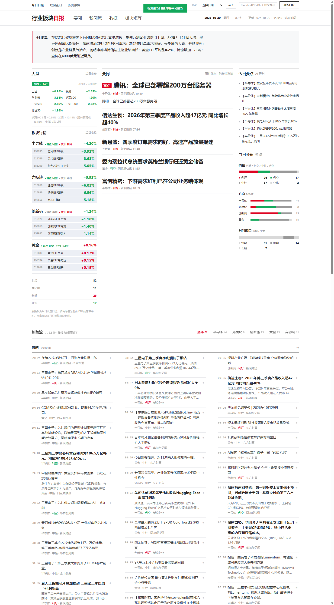
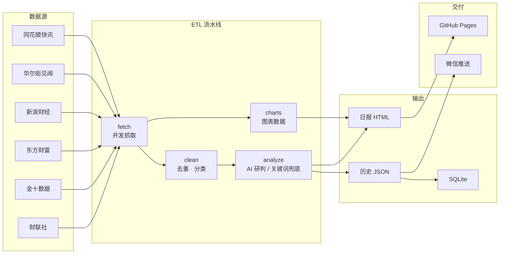

# 行业板块日报

**简体中文** · [English](README.en.md)

> 聚合六家财经媒体快讯，结合 AI 研判，每日自动生成半导体、光模块、创新药、黄金四大赛道的产业日报。

[](https://chanbigcool.github.io/daily-stock-news/)  

**[在线日报](https://chanbigcool.github.io/daily-stock-news/)** · **[数据查询](https://chanbigcool.github.io/daily-stock-news/db.html)**



## 功能

- **多源聚合** — 并发抓取财联社、金十数据、东方财富、新浪财经、同花顺快讯、华尔街见闻 6 个快讯源，并接入 12 只板块 ETF 实时行情。
- **事件级去重** — 同一事件的多家报道按加权 Jaccard、bigram 重叠与数字信号三层相似度判定，聚合为单一事件，卡片展示来源数与相关报道。
- **AI 研判** — 通过 Claude 兼容 API 为每条新闻输出中文标题、板块归类、多空方向、影响评级、置信度与研判依据；AI 不可用时自动降级为本地关键词引擎，日报照常产出。
- **板块方向校准** — 板块方向以当日 ETF 涨跌为准（±3% 硬阈值），单条新闻方向按自身内容判断，避免大跌日整版利空。
- **数据可视化** — ETF 走势、情绪分布、板块方向、冲击热力四组图表，ETF 价格逐日累积。
- **历史回溯** — 每日存档 JSON 与静态 HTML，页面按日期回溯任意历史日报。
- **真 SQL 查询** — 全量历史导入真 SQLite，浏览器内通过 sql.js 运行完整 SQL，支持 JOIN、子查询、窗口函数与 `EXPLAIN`。
- **自动发布** — 云端定时抓取 + GitHub Actions 构建部署，支持网页一键刷新，每日推送微信摘要。

## 架构



## 技术栈

| 层面 | 选型 |
|------|------|
| 运行时 | Node.js ≥ 22，ESM，零 npm 依赖 |
| 抓取 | 原生 `fetch`，JSON / JS 变量 / 正则解析 |
| AI | Claude 兼容 API（默认 GLM-4.5-Flash）+ 本地关键词引擎兜底 |
| 渲染 | 字符串拼接 HTML，内联 CSS / JS，Chart.js 4.4（本地 vendored） |
| 数据库 | `node:sqlite` 构建，sql.js（WebAssembly）浏览器查询 |
| 调度 | 腾讯云 SCF 定时触发器（北京时间 09:00 / 12:30 / 20:00） |
| 部署 | GitHub Actions + `peaceiris/actions-gh-pages` → GitHub Pages |
| 通知 | Server酱3 → 微信 |

## 快速开始

```bash
git clone https://github.com/chanbigcool/daily-stock-news.git
cd daily-stock-news

node scripts/build-daily.mjs     # 抓取 → 清洗 → 研判 → 渲染
node scripts/refresh-server.mjs  # 本地预览 http://127.0.0.1:3456
npm test                         # 运行单元测试
```

项目零 npm 依赖，无需 `npm install`。

## 项目结构

```
daily-stock-news/
├── pipeline/          # ETL 流水线：抓取 / 清洗 / 去重 / 研判 / 图表
├── scripts/           # 构建入口、本地预览服务、SQLite 构建
├── cloud/             # 腾讯云 SCF 云函数：抓取、刷新、定时调度
├── assets/            # 本地 vendored 前端依赖（Chart.js、sql.js）
├── history/           # 每日存档（JSON / HTML / 事件 / SQLite）
├── tests/             # 单元测试
├── docs/              # README 预览图
├── index.html         # 当日日报（部署入口）
├── db.html            # 数据查询页
└── .github/workflows/ # CI：测试、构建、部署
```

## 数据源

| 来源 | 内容 | 解析方式 |
|------|------|----------|
| 财联社 | 电报快讯 | JSON API |
| 金十数据 | 7×24 快讯 | JS 变量注入 |
| 东方财富 | 综合财经新闻 | RESTful JSON |
| 新浪财经 | 财经直播流 | JSON API |
| 同花顺快讯 | 滚动快讯 | JSON API |
| 华尔街见闻 | 全球宏观与 A 股 | RESTful JSON |

ETF 行情通过新浪 `hq.sinajs.cn` 批量接口获取，无需 API Key。

## AI 输出模型

| 字段 | 说明 |
|------|------|
| `title_cn` | 中文行业简讯标题 |
| `summary_cn` | 客观事实提炼，含具体公司与数据 |
| `category` | 半导体 / 光模块 / 创新药 / 黄金 |
| `direction` | 利好 / 利空 / 中性 / 分化 |
| `impact` | 极高 / 高 / 中 / 低 |
| `certainty` | 确定性：高 / 中 / 低 |
| `time_window` | 时间窗口：短期 / 中期 / 长期 |
| `tickers` | 关联 A 股标的 |
| `sentiment` / `market_impact` / `confidence_score` | 可解释性字段，与 `direction` / `impact` 保持一致 |
| `reasoning` | 研判依据 |
| `evidence` | 原文逐字引用的事实句 |
| `uncertainty` | 不确定因素说明 |

`evidence` 仅允许引用原文事实句，禁止编造数据；AI 不可用时关键词引擎派生同一套字段，两条路径契约一致。

## 自动化流程

1. 腾讯云 SCF 定时触发器每日三次抓取数据源与 ETF 行情，将结果写入 `fetch-cache` 分支并触发工作流。
2. GitHub Actions 读取抓取结果，完成清洗、去重、研判、渲染与质量校验，提交存档并部署到 GitHub Pages。
3. 网页「刷新日报」按钮经云函数触发同一条链路，约 2–6 分钟后页面更新。

CI 只消费云端抓取结果，不现场抓取；本地开发直接抓取。

## 数据查询

所有历史存档归一化为四张表的真 SQLite 数据库：

| 表 | 内容 |
|----|------|
| `news` | 单条新闻（日期、板块、方向、影响、置信度等） |
| `daily` | 日期 × 板块聚合（条数、多空分布、ETF 涨跌） |
| `companies` | 受影响公司 / 标的（频次、首末出现日期） |
| `meta` | 版本与构建元信息 |

```sql
-- 新闻与当日板块行情对照
SELECT n.date, n.cat, n.title, n.dir, d.etfChg
FROM news n JOIN daily d USING(date, cat)
WHERE n.date = '20260825' AND n.dir = '利好';
```

## 配置

| 变量 | 说明 |
|------|------|
| `ANTHROPIC_API_KEY` | Claude 兼容 API Key |
| `ANTHROPIC_BASE_URL` | API 地址，默认 `https://open.bigmodel.cn/api/anthropic` |
| `ANTHROPIC_MODEL` | 研判模型，默认 `glm-4.5-flash` |
| `SERVERCHAN_SENDKEY` | Server酱3 SendKey，配置后推送微信 |
| `REFRESH_URL` | 公网刷新代理地址 |
| `REFRESH_SECRET` | 与云函数共享的刷新密钥 |
| `FETCH_PAYLOAD` | 云端抓取结果路径（仅 CI 使用） |

## 测试

```bash
npm test
```

覆盖抓取、清洗、去重、研判、渲染、云函数与数据库构建等 13 个模块，共 221 个用例，CI 中作为构建前置门槛。

## 免责声明

本日报基于公开信息自动整理生成，AI 分析结果仅供参考，**不构成任何投资建议**。股市有风险，投资需谨慎。
