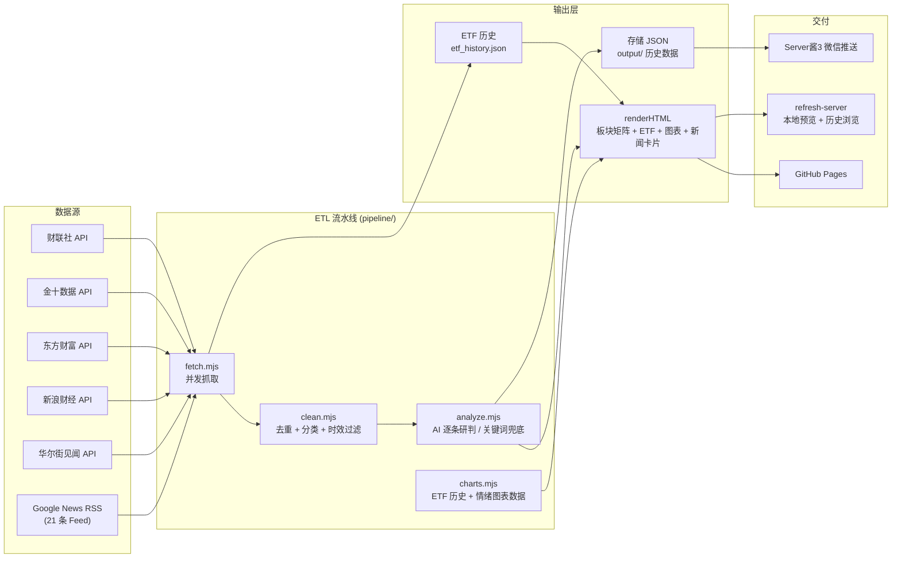

# 行业板块日报 (Daily Stock News)

> 聚焦半导体、光模块、创新药、黄金四大赛道，自动化聚合 + Claude AI 分析，生成每日产业日报并推送至微信。

---

## 架构概览



---

## 技术栈

| 层面 | 技术选型 |
|------|----------|
| 运行时 | Node.js (ESM `.mjs`, zero dependencies) |
| 数据抓取 | `fetch` API (原生 HTTP), 正则解析 XML/JSON/JS |
| AI 分析 | Claude API 或本地关键词引擎兜底 (无需密钥) |
| 渲染 | 纯字符串拼接 HTML, 内联 CSS + 原生 JS |
| 图表 | Chart.js 4.4 (CDN), 无构建时依赖 |
| 数据库 | `node:sqlite`（构建期生成真 SQLite）+ sql.js (WebAssembly，浏览器内跑完整真 SQL) |
| 定时调度 | GitHub Actions（`daily.yml` + `daily-heartbeat.yml`）。**`schedule:` 已于 2026-10-13 停用**，当前仅 `push` 与 `workflow_dispatch` 触发 |
| 部署 | `peaceiris/actions-gh-pages@v4` → GitHub Pages（国内可直连）；EdgeOne Pages 备用；jsDelivr 仅作静态资源 CDN（其对 `.html` 返回 text/plain，不能托管页面）。CI 里所有 `uses:` 均固定到 40 位 commit SHA，`npx edgeone` 固定到 `@1.6.41`——可变的 tag / `latest` 会让同一份 workflow 跑出不同行为 |
| 推送通知 | Server酱3 (微信消息推送) |
| 本地服务 | 原生 `http` 模块, 端口 `3456`, 监听 `0.0.0.0`（容器就绪） |

**零 npm 依赖**：项目不依赖任何 npm 包，全部使用 Node.js 内置模块 (`fs`, `path`, `url`, `http`, `child_process`)。Chart.js 通过 CDN 在浏览器端加载。

---

## 在线访问

- **主链接（GitHub Pages）**：<https://chanbigcool.github.io/daily-stock-news/> —— 本机实测可直连（2026-10-14 三次探测均 HTTP 200，1.5~2.0s），正确渲染为网页；每次构建后由 Actions 自动部署，构建完即可看到最新日报（页面带 no-cache 控制，普通刷新即更新）
- **公网一键刷新**：网页顶部「🔄 刷新日报」按钮在公网也可用 —— 点击后经腾讯云 SCF 云函数触发 GitHub Actions 重建，约 2~6 分钟后页面自动更新到最新版（无需本机运行任何服务）
- **辅助（EdgeOne Pages 预览，国内节点）**：构建后 3 小时内可通过 EdgeOne 预览链接查看最新版（免 CDN 缓存延迟），每次构建后去 [EdgeOne 控制台](https://edgeone.cloud.tencent.com/pages) → `daily-stock-news` 项目 → 部署列表 → 预览获取。长期稳定访问需绑定已备案自定义域名
- ~~jsDelivr 镜像~~：jsDelivr 对仓库内 `.html` 文件强制返回 `text/plain`（防钓鱼的安全设计），浏览器只会显示源代码而不会渲染成网页，因此不能作为页面入口；仅作 Chart.js 等静态资源 CDN 使用
- ~~Zeabur~~：免费档已关停（2026/3 起共享集群停止接受新项目），不再作为主链接

> **定时构建已停用（2026-10-13）**：迁移到新账号 `chanbigcool` 时，两个工作流里的 `schedule:` 都被注释掉了。旧账号被封的依据正是「在 Actions 里定时抓第三方站点」这个架构形态，新账号另起一套同样的定时抓取会被判为规避封禁并做账号关联。**当前日报只在 `push main` 或点网页刷新按钮（`workflow_dispatch`）时构建**，不再自动出报。确认要恢复定时、且接受这个风险，再去 `.github/workflows/` 里取消注释——两处代码里都写了同样的说明。

公网一键刷新通过云端代理触发，不消耗本机资源。

---

## 快速开始

```bash
# 1. 克隆仓库
git clone https://github.com/chanbigcool/daily-stock-news.git
cd daily-stock-news

# 2. 无需 npm install（零依赖）

# 3. 构建当日日报
node scripts/build-daily.mjs

# 4. 本地预览（含历史数据和手动刷新功能）
node scripts/refresh-server.mjs
# 打开 http://127.0.0.1:3456
```

### 环境变量

| 变量 | 说明 |
|------|------|
| `ANTHROPIC_API_KEY` | Claude 兼容 API Key（CI 中通过 GitHub Secrets 注入，默认指向智谱 GLM 免费端点；本地通过代理自动管理） |
| `ANTHROPIC_BASE_URL` | 可选，覆盖 Claude 兼容 API 地址（默认 `https://open.bigmodel.cn/api/anthropic`） |
| `ANTHROPIC_MODEL` | 可选，覆盖 AI 研判模型（默认 `glm-4.5-flash`，免费） |
| `SERVERCHAN_SENDKEY` | Server酱3 SendKey，配置后自动推送微信通知 |
| `EDGEONE_API_TOKEN` | EdgeOne Pages API Token（国内加速，待绑定备案域名后配置启用；未配置时自动跳过） |
| `REFRESH_URL` | 公网一键刷新代理地址（腾讯云 SCF 函数 URL），构建时注入前端按钮；未配置时用 `scripts/build-daily.mjs` 里的内置默认值 |
| `REFRESH_SECRET` | 与云函数 `SHARED_SECRET` 相同的共享密钥，构建时注入前端；未配置时**注入空串**（不内置默认值——该值会被内联进公开页面，写死等于直接发布），前端按钮将不带 `X-Refresh-Secret` 头 |

> 主链接 GitHub Pages 为纯静态托管，**无需任何环境变量**：构建/推送全部在 GitHub Actions 完成，每次构建后自动部署，构建完即可看到最新日报。公网一键刷新的**代理地址**有内置默认值（见 `scripts/build-daily.mjs`），**密钥没有**——`REFRESH_SECRET` 未配置时注入空串，云函数侧比对不上就会返回 401。要让刷新按钮在公网可用，必须在仓库 Secret 里配 `REFRESH_SECRET`，并与云函数的 `SHARED_SECRET` 保持一致（部署与轮换步骤见 [cloud/README.md](cloud/README.md)）。

---

## 项目结构

```
daily-stock-news/
├── .github/workflows/
│   ├── daily.yml               # 主构建:push main / 手动触发,构建/提交/部署(schedule 已停用)
│   └── daily-heartbeat.yml     # 心跳自愈:当天存档缺失才补建(schedule 已停用)
├── cloud/                      # 公网一键刷新代理(腾讯云 SCF;部署与密钥轮换见 cloud/README.md)
│   ├── index.js                # 云函数本体(CommonJS,SCF 的 index.handler 入口)
│   ├── tc-call.mjs             # 腾讯云 API v3 签名调用
│   └── deploy.mjs              # 打包上传 index.js + 创建/更新函数 + 写环境变量
├── scripts/
│   ├── build-daily.mjs            # 构建入口（编排 ETL 流水线 + 渲染 + 推送）
│   ├── db-build.mjs               # 数据库构建（node:sqlite 聚合 history/ → db.sqlite）
│   ├── cloud-refresh.mjs          # 云函数的 ESM 孪生版（本地调试用，线上跑 cloud/index.js）
│   └── refresh-server.mjs         # 本地刷新服务（端口 3456，含历史 API，仅本机）
├── pipeline/
│   ├── config.mjs                 # 配置中心（API 源、RSS Feed、ETF 列表、关键词规则）
│   ├── utils.mjs                  # 工具函数（HTML 清洗、日期格式化）
│   ├── sectors.mjs                # 板块常量与共享工具（名称/CSS class/颜色/impact 排序）
│   ├── fetch.mjs                  # 数据抓取层（5 API + 21 RSS + 12 ETF 行情）
│   ├── health.mjs                 # 抓取健康判定（纯函数：ok / degraded / failed）
│   ├── classifier.mjs             # 板块分类规则引擎（clean 与 analyze 共用的唯一分类出口）
│   ├── clean.mjs                  # 清洗层（去重、事件聚类、板块分类、时效性过滤）
│   ├── events.mjs                 # 事件级去重（三层漏斗 + 可插拔 Embedding 钩子）
│   ├── sentiment.mjs              # 利好/利空 + 冲击评分引擎（可配置权重语义信号）
│   ├── companies.mjs              # 四赛道 A 股公司词典（名称 → ticker）
│   ├── analyze.mjs                # AI 分析层（Claude 兼容 API 逐条研判 + 关键词引擎兜底）
│   └── charts.mjs                 # 图表数据层（ETF 历史累积、情绪/冲击/方向数据集）
├── assets/                        # 前端静态资源（vendored，无 CDN 依赖）
│   ├── chart.umd.min.js           # Chart.js 4.4
│   ├── sql-wasm.js / sql-wasm.wasm # sql.js（SQLite WebAssembly，数据查询页真引擎）
│   └── db-client.js               # 数据查询页逻辑（加载 db.sqlite + 表单筛选 + SQL 控制台）
├── output/                        # 构建产物
│   ├── 股市热点日报_20260804.html
│   ├── 股市热点日报_20260804.json
│   ├── etf_history.json           # ETF 价格历史（趋势图数据源）
│   └── ...
├── history/                       # 历史存档（按天 JSON + 静态 HTML + 事件存档 + 状态）
│   ├── 日报_YYYYMMDD.json         # 当日全量数据
│   ├── 日报_YYYYMMDD.html         # 静态历史页
│   ├── events_YYYYMMDD.json       # 当日事件级去重结果（含多来源聚合）
│   ├── build-state.json           # 本次构建状态（阶段/funnel/health/时间戳），前端据此判断是否自动刷新
│   ├── dates.json                 # 日期索引
│   └── db.sqlite                  # 全量真 SQLite（数据查询页数据源）—— 构建产物，不入库
├── quality/                       # 产出质量校验报告（quality/index.html + report.json）
├── tests/                         # 单元测试（11 个文件 / 206 个用例，node --test 自动发现）
│   ├── analyze.test.mjs           # AI 研判 + 关键词兜底引擎
│   ├── clean.test.mjs             # 清洗层（去重、板块分类、时效过滤）
│   ├── cloud-deploy.test.mjs      # 云函数打包（手写 zip 的字节结构 + CRC32）
│   ├── db-build.test.mjs          # 数据库构建（归一化 + 端到端导入断言）
│   ├── events.test.mjs            # 事件级去重（三层相似度漏斗）
│   ├── fetch.test.mjs             # 抓取层（超时、降级、并发）
│   ├── health.test.mjs            # 抓取健康判定（ok / degraded / failed）
│   ├── push-gate.test.mjs         # 空报告闸门
│   ├── quality.test.mjs           # 产出质量校验
│   ├── render-html.test.mjs       # HTML 渲染（板块矩阵 + 卡片 + 图表）
│   └── sentiment.test.mjs         # 情绪/方向推导与可解释性字段契约
├── index.html                     # 当日日报（部署入口）
├── db.html                        # 数据查询页（表单筛选 + SQL 控制台，根级静态页）
├── package.json
└── .gitignore
```

---

## 核心功能

- **模块化 ETL 流水线** — `pipeline/` 目录 12 个模块，职责分离：`fetch`（数据抓取）→ `clean`（去重分类）→ `analyze`（AI 分析）→ `charts`（图表数据），另有 `health`（抓取健康判定）、`sentiment`（情绪评分）、`classifier`（分类规则）、`companies`（公司词典）、`sectors`（板块常量）等支撑模块，`scripts/build-daily.mjs` 负责编排 + HTML 渲染 + 推送
- **多源聚合** — 5 个中文财经 API 直连 + 21 条 Google News RSS Feed，8 路并行分批抓取。直接 API 源优先于 RSS 源去重
- **事件级去重** — 同一财经事件被不同媒体以不同标题报道（如财联社「现货黄金站上4600美元」与华尔街见闻「现货黄金突破4600美元」）→ 自动聚合为单个 Event：加权字符 Jaccard（实体词满权重、泛财经词降权）+ bigram overlap + 信号类别加成三层相似度判定，共享具体价格点位等数字时强合并；聚合结果收敛为代表条目继续走 AI 研判，卡片展示来源聚合徽标（N 家）与相关报道列表；事件存档至 `history/events_YYYYMMDD.json`
- **AI 智能分析** — Claude 兼容 API（默认智谱 GLM 免费模型）对新闻逐条研判，输出中文标题、板块归类、方向判断（利好/利空/中性/分化）、影响评级（极高/高/中/低），附带确定性评分和时间窗口，每条简讯关联 A 股标的；AI 不可用时自动降级为本地关键词引擎
- **板块方向硬校准** — 板块方向看行情、单条新闻看内容：板块最终方向以当日 ETF 实际涨跌为准（±3% 硬阈值）：跌超 3% 强制利空、涨超 3% 强制利好、±1%~3% 强制中性、±1% 内由板块内新闻加权投票决定；单条新闻方向完全按自身内容判断，不被板块行情强制翻转，避免大跌日整版利空
- **关键词引擎兜底** — API 不可用时自动降级为本地关键词匹配引擎（含涨跌行情信号，覆盖四大赛道），保证日报照常出；已支持否定词中和（「暂停降息」不再命中降息利好）、程度词分级（「小幅回落」与「暴跌」不同冲击）、四赛道 A 股公司→ticker 映射（填充受影响公司与标的）
- **数据可视化** — Chart.js 渲染 4 张图表：ETF 价格走势折线图、情绪分布环形图、板块方向堆叠柱状图、冲击热力图；ETF 价格数据每日累积至 `etf_history.json`
- **板块 ETF 实时指标** — 新浪财经 `hq.sinajs.cn` 批量拉取 12 只 ETF 实时行情，按板块分组展示
- **历史数据浏览** — 每日输出 JSON 结构化数据，前端下拉框按日期回溯，刷新服务动态渲染（含图表）
- **微信推送** — Server酱3 每日推送 Markdown 摘要（板块 ETF + 核心数据 + TOP 3 + 要点）
- **一键刷新** — 网页按钮触发完整管线：重建 → git commit → git push，前端轮询状态，完成后自动重载。公网走云端代理（腾讯云 SCF 触发 Actions 重建），本机走 refresh-server（/refresh → 重建 → push）
- **GitHub Actions 自动化** — 构建并部署到 GitHub Pages；单元测试前置为 CI 门槛，不过测试不构建、不部署。定时 `schedule:` 已于 2026-10-13 停用（原因见上方「在线访问」），现由 `push` / 手动刷新 / `workflow_dispatch` 触发

---

## 数据源详情

### 直连 API（5 路）

| 来源 | 数据特点 | 解析方式 |
|------|----------|----------|
| 财联社 (cls.cn) | 电报快讯，更新频率高 | JSON API, 提取 `roll_data` |
| 金十数据 (jin10.com) | 7x24 快讯，带【标签】格式 | JS 变量注入格式解析 |
| 东方财富 (eastmoney.com) | 综合财经新闻，多栏目 | RESTful JSON API |
| 新浪财经 (sina.com.cn) | 财经直播流 | JSON API |
| 华尔街见闻 (wallstreetcn.com) | 全球宏观 + 中国市场 | RESTful JSON API |

### Google News RSS（21 条 Feed）

全部为 Google News 关键词检索（`hl=zh-CN`），按赛道（四板块 / 创新药 / 黄金）与来源细分：财联社、金十数据、新浪财经、华尔街见闻、21 世纪经济、经济观察报、第一财经，以及各赛道龙头与业绩词条。每条 Feed 按关键词精确匹配四大赛道。

> 说明：这里**只做中文检索**。历史版本的 README 曾写「覆盖中/英/日/韩多语种，含 Reuters、Bloomberg、CNBC、WSJ、FT、Nikkei Asia」，但 `pipeline/config.mjs` 里 21 条 Feed 的 `hl` 全是 `zh-CN`，URL 中也没有任何海外媒体域名——那些来源从未存在过。

### ETF 行情数据

从 `hq.sinajs.cn` 批量拉取 12 只 A 股 ETF 实时价格，无需 API Key。

---

## 本地刷新服务 API

`refresh-server.mjs` 为**本地预览专用**（`http://127.0.0.1:3456`），提供手动刷新与历史浏览：

| 方法 | 端点 | 说明 |
|------|------|------|
| `GET` | `/` | 查看最新 index.html |
| `GET` | `/history/dates` | 获取所有历史日期列表 (JSON) |
| `GET` | `/history?date=YYYYMMDD` | 查看指定日期的历史日报 |
| `POST` | `/refresh` | 触发重建 → git commit → git push |
| `GET` | `/status` | 查询刷新任务状态 |

> **注意**：`/refresh` 会执行 `git push`，因此该服务刻意只监听本机（刷新按钮在前端用 `isLocalHost()` 门控，公网域名下自动禁用）。公网站点为纯静态托管：历史下拉框读静态文件 `history/dates.json` 与 `history/日报_YYYYMMDD.html`，不需要此服务。

---

## 数据库与查询（db.html）

> 全量历史存档导入**真 SQLite**，前端在浏览器内跑完整真 SQL —— 语法与命令行 `sqlite3` 行为一致，无任何子集限制（支持 JOIN / 子查询 / 窗口函数 / 索引）。

### 原理

- **构建期**：`scripts/db-build.mjs` 用 Node 内置 `node:sqlite` 扫描 `history/日报_*.json` 全量存档，降维归一化后写入 `history/db.sqlite`（build-daily 主流程 step 7.6 自动调用；也可独立运行 `node scripts/db-build.mjs`）
- **查询期**：`db.html` 用 vendored 的 sql.js（SQLite 官方 C 代码编译为 WebAssembly）把 `.sqlite` 加载进浏览器内存，`SQL.Database` 就是一个真 SQLite 实例。表单筛选只是把条件翻译成 SQL 字符串，交给同一个真引擎执行
- 每次构建覆盖 `history/db.sqlite`，随 `git add history/` 自动提交，GitHub Pages 部署后线上即为最新版，**无需任何后端**

### 四表结构（真 CREATE TABLE）

```sql
CREATE TABLE news(          -- 单条新闻（全量，日期+板块+方向+影响+置信度等 15 列）
  id TEXT, date TEXT NOT NULL, cat TEXT, dir TEXT,
  impact TEXT, certainty TEXT, tw TEXT, tickers TEXT, title TEXT,
  summary TEXT, source TEXT, pubDate TEXT, comps TEXT, link TEXT, score REAL);
CREATE INDEX idx_news_date ON news(date);
CREATE INDEX idx_news_cat  ON news(cat);
CREATE INDEX idx_news_dir  ON news(dir);

CREATE TABLE daily(         -- 日期×板块聚合（条数/利好/利空/…/ETF 涨跌/冲击/摘要）
  date TEXT NOT NULL, cat TEXT NOT NULL,
  count INTEGER, bull INTEGER, bear INTEGER, mix INTEGER, neu INTEGER,
  vhigh INTEGER, high INTEGER, mid INTEGER, low INTEGER,
  etfChg REAL, shock TEXT, tickers TEXT, summary TEXT,
  PRIMARY KEY(date, cat));

CREATE TABLE companies(     -- 受影响公司/标的名（频次 + 首末出现日期 + 板块集合）
  name TEXT PRIMARY KEY, ticker TEXT, cats TEXT,
  count INTEGER, firstDate TEXT, lastDate TEXT);

CREATE TABLE meta(key TEXT PRIMARY KEY, value TEXT);  -- version/generatedAt/days/newsCount
```

页面「表结构」按钮直接从 `sqlite_master` 读出这四张表的真实建表语句。

### 真外键 vs 概念外键

三个业务表通过 `date` / `cat` / `name` **概念关联**，但未声明 `FOREIGN KEY` 约束：`news.date` 与 `daily.date`、`news.comps`（`|` 分隔的公司名）与 `companies.name` 是应用层约定，SQLite 不强制。这是刻意简化——外键约束是 SQL 的重要概念，可以在控制台用 `PRAGMA foreign_keys=ON;` 手动开启，对比「概念外键」与「强制外键」的行为差异。

- 教学例：`news JOIN daily USING(date, cat)` 是真可跑的 JOIN（连接键 = 日期 + 板块）
- 「EXPLAIN」按钮输出 `EXPLAIN QUERY PLAN`：观察 `SEARCH ... USING INDEX idx_news_date`（走索引）与 `SCAN news`（全表扫描）的区别

### 常用 SQL 示例

```sql
-- 某天某板块的新闻，按置信度排序
SELECT title, source, score FROM news
WHERE date='20260825' AND cat='光模块' ORDER BY score DESC;

-- 按板块聚合：条数 + 平均置信度
SELECT cat, COUNT(*) AS 条数, ROUND(AVG(score), 2) AS 平均置信
FROM news GROUP BY cat ORDER BY 条数 DESC;

-- 新闻 JOIN 板块日报：新闻方向 + 当日 ETF 涨跌对照
SELECT n.date, n.cat, n.title, n.dir, d.etfChg
FROM news n JOIN daily d USING(date, cat)
WHERE n.date='20260825' AND n.dir='利好';

-- 每日新闻量趋势（前端趋势图的等价 SQL）
SELECT date, COUNT(*) FROM news GROUP BY date ORDER BY date;
```

### 页面功能

| 功能 | 说明 |
|------|------|
| 表单筛选 | 日期/板块/方向/影响/关键词 → 自动生成 WHERE 子句，页面同时展示**等价 SQL**（学 SQL 最快的方式：点按钮对比生成的语句） |
| SQL 控制台 | 任意真 SQL 直接运行（含 JOIN / GROUP BY / 子查询），显示行数 + 耗时，`Ctrl+Enter` 快捷运行 |
| EXPLAIN | 查看查询计划，对比索引加速前后的搜索方式 |
| 表结构 | 从 `sqlite_master` 读取四张表的真实建表语句 |
| 趋势图 | 筛选结果按日期的新闻量折线图（Chart.js） |

---

## AI 分析输出模型

每条新闻在传统评级（`direction`/`impact`/`certainty`/`time_window`）之外，附带**可解释性字段**，说明结论的依据：

| 字段 | 类型 | 说明 |
|------|------|------|
| `title_cn` | string | 中文行业简讯标题 |
| `summary_cn` | string | 客观事实提炼，含具体公司/数据 |
| `category` | enum | `半导体` / `光模块` / `创新药` / `黄金` |
| `direction` | enum | `利好` / `利空` / `中性` / `分化` |
| `impact` | enum | `极高` / `高` / `中` / `低` |
| `certainty` | enum | `高` / `中` / `低` |
| `time_window` | enum | `短期` / `中期` / `长期` |
| `tickers` | string | 关联 A 股标的 |
| `notes` | string | 补充说明 |
| `sentiment` | enum | 结论方向（AI 视角）：`利好` / `利空` / `中性` / `分化` |
| `market_impact` | enum | 影响强度（AI 视角）：`极高` / `高` / `中` / `低` |
| `affected_companies` | string[] | AI 抽取的受影响公司/标的名 |
| `reasoning` | string[] | 研判依据，逐条给出理由 |
| `evidence` | string[] | 证据：**逐字引用原文（标题/描述）中的事实句** |
| `confidence_score` | number | 置信度 `0.0~1.0`（≥0.75 高 / ≥0.5 中 / <0.5 低） |
| `uncertainty` | string | 不确定因素说明（留空表示无明显不确定项） |

**可解释性约定**：
- **新字段为真源**：`direction`/`impact`/`certainty` 由 `sentiment`/`market_impact`/`confidence_score` 推导，新旧字段始终一致、绝不矛盾。
- **evidence 防幻觉**：AI 被强制要求只引用原文存在的事实句，禁止编造原文不存在的数据、数字、公司、事件；无法引用原文时 `evidence` 留空。渲染时标注「AI 提取，请以原文为准」。
- **关键词引擎兜底**：API 不可用时降级的关键词引擎同样派生这 7 个字段（`evidence`=命中的具体关键词），两路径字段契约完全一致。
- **容错**：AI 返回异常时逐字段防御回退（非法枚举回落关键词基线、非数组置空、置信度越界收敛），不会因单个字段异常丢弃整条新闻。

---

## 免责声明

本日报基于公开信息自动整理生成，AI 分析结果仅供参考，**不构成任何投资建议**。股市有风险，投资需谨慎。
